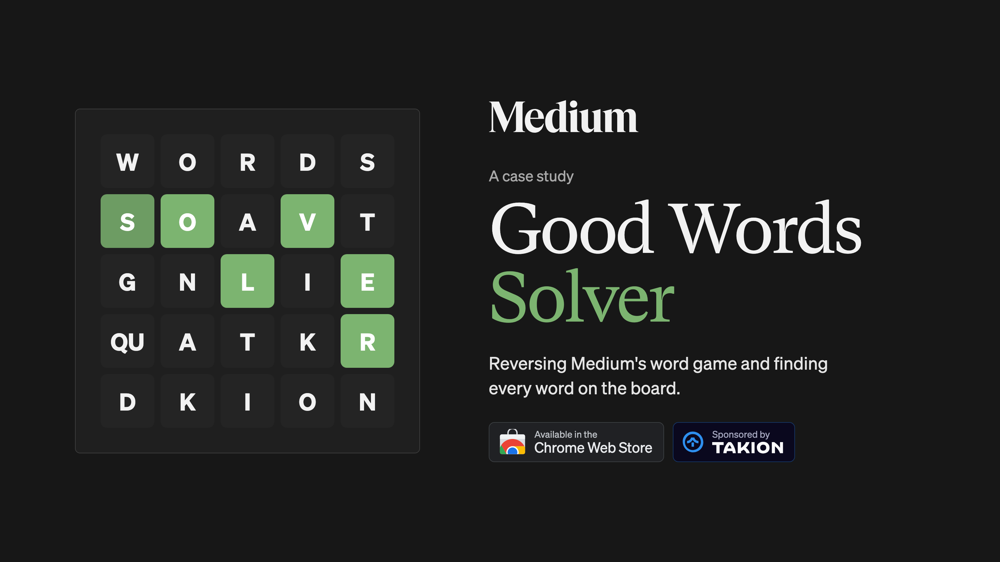
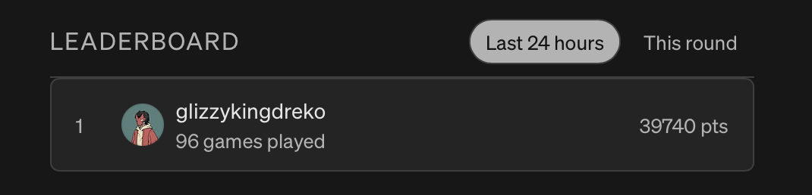
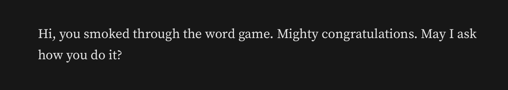

# Medium's Good Words Solver

<div align="center">
  
  
  
  
  
  <a href="https://github.com/glizzykingdreko/medium-good-words-solver/releases/latest"></a>
  <a href="https://github.com/glizzykingdreko/medium-good-words-solver"></a>
  <a href="https://chromewebstore.google.com/detail/good-words-solver-by-taki/aeagbadhifkaigikmlbepfhggbdgmomk"></a>
  <br />
  <a href="https://takionapi.tech/?utm_source=github&utm_medium=readme&utm_campaign=good-words-extension&utm_content=badge-sponsor"></a>
  <a href="https://takionapi.tech/blog/medium-good-words-solver?utm_source=github&utm_medium=readme&utm_campaign=good-words-extension&utm_content=badge-article"></a>
  <br />
</div>




A case study / chrome extension to auto solve Medium's **Good Words** game.

## Table of Contents

- [Introduction](#introduction)
- [The game](#the-game)
- [Analyzing the requests](#analyzing-the-requests)
  - [The dictionary files](#the-dictionary-files)
  - [The websocket](#the-websocket)
- [The game solves itself](#the-game-solves-itself)
- [Solo boards are predictable](#solo-boards-are-predictable)
- [Building the extension](#building-the-extension)
  - [1. Read the board](#1-read-the-board)
  - [2. Find the words](#2-find-the-words)
  - [3. Submit a word](#3-submit-a-word)
- [Demo](#demo)
- [Note](#note)
- [Conclusion](#conclusion)
- [Need help with Cloudflare?](#need-help-with-cloudflare)
- [Connect with me](#connect-with-me)

## Introduction

Medium just launched **Good Words**, a little multiplayer word game living at `medium.com/games/good-words`. 

So I just wondered how hard would have been to "automatize" the solving of it.
Just a quick project done in a few minutes that, posting just as a study case.

## The game

Simples rules:
- 5x5 grid of letter
- 3m for round
- 30s break
- everyone plays the same board at the same moment
- u have to find words by matching nearby letters in whatever direction, min 4 letters for word

The points you earn for words are based on the letters count

| Length | Points |
|---|---|
| 4 | 1 |
| 5 | 2 |
| 6 | 4 |
| 7 | 8 |
| 8 | 15 |
| 9 | 25 |
| 10 | 40 |
| 11+ | 60 |

Basically a [Boggle](https://en.wikipedia.org/wiki/Boggle) modernized.

But let's get to the point!

## Analyzing the requests

By checking the game page, the important requests I found where:

### The dictionary files

- `.../goodwords/words.txt?v=6eeb79b5190c` - dictionary
- `.../goodwords/freq.bin?v=6eeb79b5190c` - word frequencies
- `.../goodwords/vocab.json?v=6eeb79b5190c` - definition

The three static files all carry the same version tag, `?v=6eeb79b5190c`, hardcoded in the bundle:

```js
function Vn(){return"https://cdn-client.medium.com/lite/static/goodwords"}
function qn(){return"?v=6eeb79b5190c"}
```

- `words.txt` - 171,624 words, one per line. the words you type gets checked against this list.
- `freq.bin` - tells the game how common a word is.
- `vocab.json` - the definitions. used for the bonus clue and the "Worth knowing" list after each round.

### The websocket

The multiplayer part runs on `wss://goodwords.medium.com/api/play`. Protected under Cloudflare.

When the websocket fails, the game doesn't care. It just switches to **solo mode** and keeps going. Keep this in mind.

The messages are simple JSON:

```js
// client -> server
{ t: "hello", name, id, token }
{ t: "word", w: "pestered" }

// server -> client
{ t: "board", round, board, ... }
{ t: "ok", w }
```

## The game solves itself

After every round the game shows "X of Y points". To know `Y`, it has to find every possible word on the board. So the solver is already inside the bundle.

How it works:

1. Load `words.txt` into a **trie** (a letter tree)
2. Start from every tile
3. Walk to the nearby tiles, one letter at a time
4. Stop as soon as no word starts with those letters
5. Save every real word with 4+ letters

Pretty simple logic.

## Solo boards are predictable

In solo mode the board is not sent by any server. The game creates it from the current round number:

```js
const round = Math.floor(Date.now() / 210000); // 3m + 30s
const board = dealBoard(round);
```

`dealBoard` shuffles the 25 dice with a random generator seeded with the round number. Same round, same board, for everyone.

I ported it to Python and checked it against the original JS. Same boards, same words. So you can get the board of any round, even future ones.

## Building the extension

The extension does three things.

### 1. Read the board

Every tile in the page has its position in a `data-cell` attribute:

```html
<div data-testid="goodWordsBoard">
  <button data-cell="0">S</button>
  <button data-cell="1">QU</button>
  ...
</div>
```

So reading the board is just reading 25 buttons.

### 2. Find the words

Now we have the 25 letters. The extension downloads the same `words.txt` the game uses and runs the same search the game runs. So we validate an input exactly like the game does.

### 3. Submit a word

The input box is a React input. Setting `input.value` alone doesn't work, React ignores it. This does:

```js
Object.getOwnPropertyDescriptor(HTMLInputElement.prototype, "value").set.call(input, word);
input.dispatchEvent(new Event("input", { bubbles: true }));
requestAnimationFrame(() => input.form.requestSubmit());
```

Set the value, tell React it changed, submit. The game then checks the word and sends it like you typed it.

## Demo

Here's the extension in action:

[](https://www.youtube.com/watch?v=mLdeQa603z8)


## Note

While writing this article I forgot a chrome window opened for some hours, getting me to the last 24h leaderboard



seems I got noticed by some platers too




## Conclusion

And that's pretty much it. I added a nice UI just in case, but in the end it's a simple search over every word the available letters can make, checked against the game's own dictionary.

Did I achieve anything by doing this? Not at all. It was just for fun, to see how the game is made. It's not my intention to ruin anyone's game experience, and I don't recommend using this extension to anyone.


## Need help with Cloudflare?

<p align="left">
  <a href="https://takionapi.tech/bypass/cloudflare?utm_source=github&utm_medium=readme&utm_campaign=good-words-extension&utm_content=cloudflare-banner">
    
  </a>
</p>


A websocket getting challenged by Cloudflare is the kind of thing that breaks every automation the moment it leaves a real browser. If you need to get through Cloudflare and friends without babysitting a headless browser, check out [TakionAPI](https://takionapi.tech/bypass/cloudflare?utm_source=github&utm_medium=readme&utm_campaign=good-words-extension&utm_content=cloudflare-text), we know what we're doing.

Start right away with a [free trial](https://takionapi.tech/trial?utm_source=github&utm_medium=readme&utm_campaign=good-words-extension&utm_content=cloudflare-trial)

## Connect with me

If you enjoyed this article, follow me on GitHub and on Medium to receive notifications whenever I post or open-source something.

- [GitHub](https://github.com/glizzykingdreko)
- [Twitter](https://mobile.twitter.com/glizzykingdreko)
- [Medium](https://medium.com/@glizzykingdreko)
- [Email](mailto:glizzykingdreko@protonmail.com)
- [Buy me a coffee ❤️](https://www.buymeacoffee.com/glizzykingdreko)
- [TakionAPI](https://takionapi.tech/?utm_source=github&utm_medium=readme&utm_campaign=good-words-extension&utm_content=connect-list)
